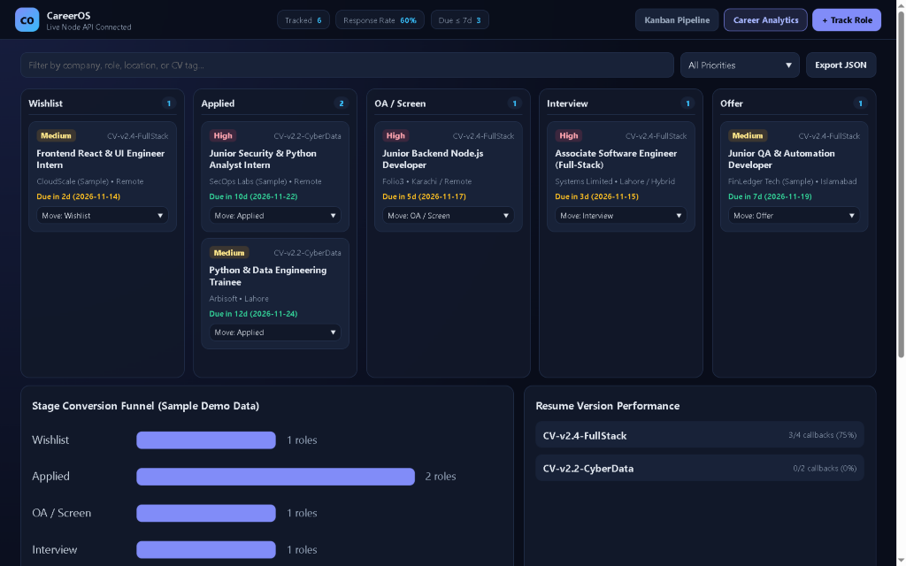

# CareerOS — Job Application Pipeline & Analytics

> A job application tracking system with drag-and-drop Kanban stages, deadline monitoring, resume-version callback analytics, and JSON export.

---

## Application Preview




## Features

- **Drag-and-Drop Kanban Pipeline:** Organize applications across `Wishlist`, `Applied`, `OA / Screen`, `Interview`, `Offer`, and `Archived` with accessible quick-move dropdowns and instant search/priority filters.
- **Deadline Urgency Tracking:** Highlights overdue or upcoming (`<= 7 days`) deadlines across applications.
- **Resume Version & Funnel Analytics:** SVG stage-conversion funnel and per-CV callback rate table (`CV-v2.4-FullStack` vs `CV-v2.2-CyberData`).
- **Dual Mode Persistence:** Runs against a zero-dependency Node.js REST API (`backend/server.js`) or in standalone browser demo mode (`localStorage`) when hosted statically.

---

## Setup & Testing Locally

```bash
node backend/server.js
```

Open `http://127.0.0.1:5070`.

Run integration tests:

```bash
node --test tests/careeros.test.mjs
```

---

## Author

**Muzammil Shabbir**  
GitHub: [@Muzammil-s](https://github.com/Muzammil-s) · Email: muzammilw10@gmail.com
